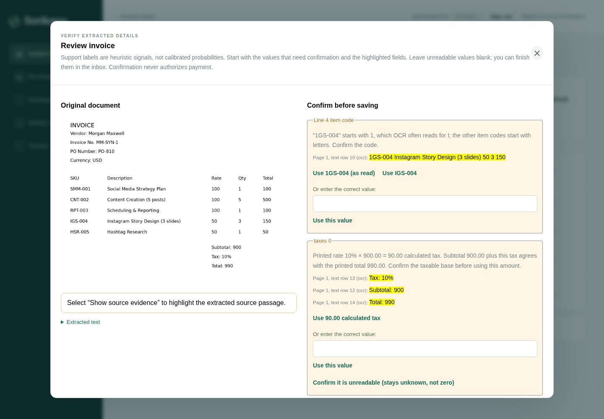
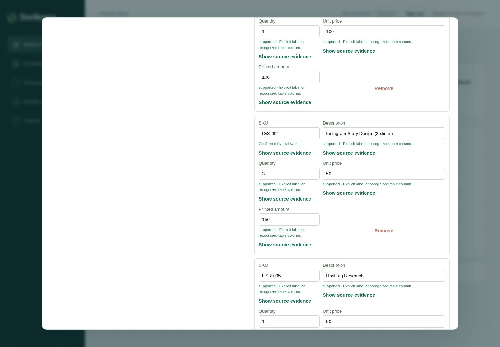
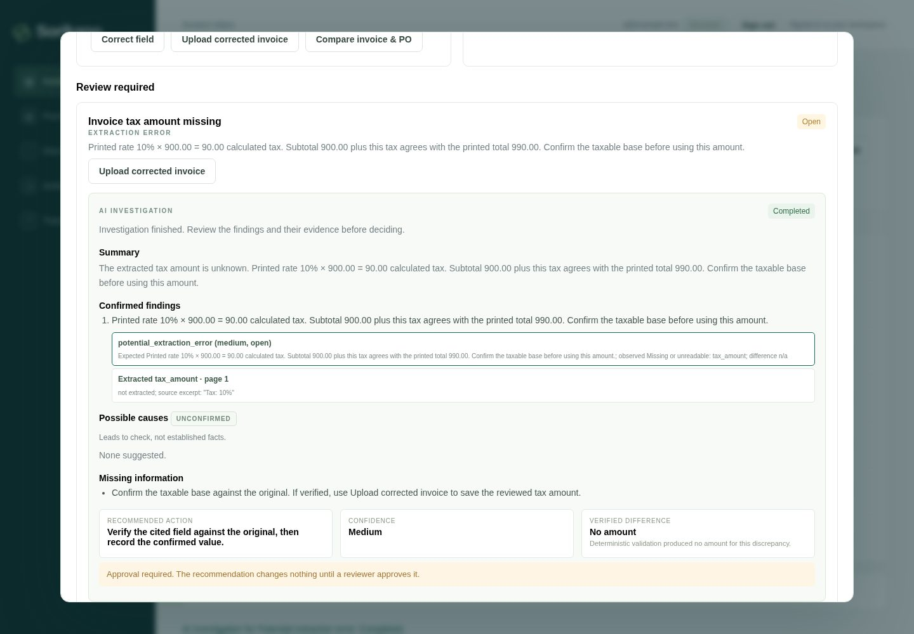

# Phase 0 financial extraction review

**Recommendation: keep Phase 0 open.** The reported quantity reversal and unsupported line-amount suggestions have targeted regression coverage. Tax proposals now show their calculation and source. Degraded scans can still lose entire invoice lines, and a production two-account acceptance run is outstanding.

## Changes and evidence

| Reported issue | Cause | Change and verification |
|---|---|---|
| Quantity and rate reversed | The spatial reader understood separate header cells. A collapsed header could lose its mapping, and multiplication gave the same result in either order. | Read the complete sequence of labels and carry the order into row fallback. Ruled image grids map the recognized labels to cells. Distinct, unlabeled numeric factors require field confirmation. Tests cover integer and decimal prices, alternative labels, printed contradictions and ambiguous layouts. |
| Unsupported $50 line-amount changes | The subtotal check tried adding the entire residual to each OCR operand and offered one-digit alternatives. | Eliminate those input substitutions. Keep the printed amount, line calculation, printed line sum and subtotal visible. Ask the reviewer to check the original for omitted or repeated rows, columns, decimals and adjustments. Line-level and final-total OCR hypotheses still require confirmation. |
| Percentage-only tax disappeared | The summary reader discarded a recognized rate when no money token followed it. | Retain rate and blank printed amount separately. One rate, a supported base and a matching printed total can produce an optional calculated amount. Integer-cent multiplication rounds half away from zero. Complex or conflicting cases stay pending. The reviewer can confirm, correct or leave the amount unknown. |
| Generic investigation instruction | The missing-tax finding recorded the missing field but supplied no calculation to the investigator. | The server rereads the saved source and checks the persisted subtotal and total before exposing a potential tax correction. The investigation presents the unknown original amount, rate, base, calculated amount, cross-check and next step. Approval and corrected upload stay separate auditable actions. |
| Invoice identity and nonstandard lines | Generic issuer references were missed, a title could become part of a letterhead, and text fallback could mistake registration numbers for priced rows. | Prefer specific invoice IDs. Offer a single plausible issuer reference for confirmation. Separate adjacent invoice titles from supplier names. Handle percent charges as a basis and rate, numeric description continuations with spatial evidence, and registration labels. |
| Credit notes and duplicate prompts | PDF and image intake lacked the JSON credit-note guard. Confirmation cards could repeat their current value. | Recognize supported credit titles before invoice review, skip ordinary credit arithmetic, and reject identifiable credits at invoice intake. Present distinct choices for the same value. |

Browser evidence uses synthetic source documents reconstructed from the reported values. The original customer uploads were unavailable. The older Morgan fixture uses HTG-005 and prints the $90 amount. The new regression uses HSR-005 and prints only 10%. Both were tested.







## DrewKraken regression

Both runs processed the same 181-file manifest at upstream revision `835afa049c42b84bb618e54cf3ec2423ccaa48a5`. Baseline was latest main `64fa131`, candidate extraction was frozen at `57500dc`. The original Python scorer and keys were unchanged. The Node harness used the same PDF and Tesseract settings for both runs. The adapter now reports the detected document type. Unknown printed tax stays null for scoring even when the reviewer has a calculated candidate.

| Measure | Baseline | Candidate |
|---|---:|---:|
| All key header fields correct | 107/181 | 108/181 |
| Individual key fields correct | 1,286/1,576 | 1,297/1,576 |
| Supplier | 155/181 | 155/181 |
| Invoice number | 135/179 | 136/179 |
| Issue date | 149/179 | 149/179 |
| Due date | 105/140 | 105/140 |
| Currency | 153/179 | 153/179 |
| Subtotal / printed tax / total | 140 / 139 / 141 of 179 | 140 / 139 / 141 of 179 |
| Document type | 169/181 | 179/181 |
| Exact line count | 136/179 | 142/179 |
| All lines correct / mean line F1 | 118/179 / 0.731 | 118/179 / 0.728 |
| Inconsistent / multi-invoice flagged | 5/5 and 2/2 | 5/5 and 2/2 |
| Consistent documents flagged | 11/172 | 3/172 |
| Documents with explicit field confirmations | 12/181 | 26/181 |
| Extraction failures / timeouts | 3 / 0 | 3 / 0 |
| Cumulative processing time | 151.9 seconds | 188.2 seconds |

Six cleared false alarms were credit notes. The other two concerned a multi-currency document and a low-light photograph. The three extraction failures in both runs were the 6- and 8-page files above the five-page product limit. Timings are single observations on a shared runner under different load. All inputs remain in the denominator.

Mean line F1 declined on six OCR inputs. The severe handwritten case admitted a malformed VAT row. Low light, low resolution and severe noise admitted partial rows without amounts. One shadowed image admitted several misaligned rows, and a stamped image joined text across a line boundary. These are remaining extraction errors even when the review screen shows uncertain fields. The candidate retained all baseline fully correct line-item documents. The attached files include the upstream field verdicts, expected and observed values, parser diagnostics, per-document time, and every remaining failure. [Per-document CSV](../../benchmark/phase0-financial/kraken/documents.csv) · [Full outputs](../../benchmark/phase0-financial/kraken/)

## Frozen supplemental evaluation

The new synthetic pack contains 48 documents drawn from 16 scenarios in three batches, including three invoice/PO pairs. The generator reads back the rendered PDF cells using a separate PDF library and checks quantities, rates, amounts and totals with Python Decimal before producing the scan and simulated photograph variants. The thirteen rasterized documents were also visually inspected. This is an engine-independent machine check with common authorship. The synthetic templates and three recurring suppliers limit generalization to new customers. No extraction fixes followed inspection of these results. [Frozen keys, documents and per-case results](../../benchmark/phase0-financial/unseen/)

| Node result | Observed |
|---|---:|
| Invoices and POs / unsupported credits | 45 / 3 |
| SKU / description / printed amount | 84/90 each |
| Quantity / unit price | 82/90 each |
| Reversed assignments / silent reversals | 2 / 0 |
| Documents requesting explicit field confirmation | 7/45 |
| Headerless cases prompting a quantity decision | 1/3 |
| Genuine arithmetic discrepancies flagged | 6/6 |
| False arithmetic alarms | 3/39 consistent invoices and POs |
| Correct rate-only proposals | 6/6 |
| Incorrect alternative amounts offered for scored line amounts, subtotal or total | 0 |
| Credits blocked / extraction exceptions | 3/3 / 0 |
| Cumulative processing time | 8.4 seconds |

The two provisional swaps occurred on the same headerless PDF. Both were flagged for review. The headerless scan and photograph (cases 19 and 35) yielded zero lines in Node. A third document also missed its lines. Exception counts alone understate failure. The benchmark measures explicit prompts separately from the general review required on upload. Chromium ran the actual file loader on all 48 inputs in 27.3 seconds with no exceptions. It recovered all 90 SKUs, descriptions and amounts. It correctly assigned 84/90 quantities and unit prices, and required confirmation for both lines on all three headerless documents. There were zero silent swaps. It flagged 5/6 genuine contradictions and raised three false alarms on the multiple-rate examples. The wrong-subtotal scan (case 25) did not receive a confirmed contradiction. Browser and Node coverage matter independently. [Browser per-document output](../../benchmark/phase0-financial/unseen/browser-results.json)

## Application verification

- Frontend tests including both live Tesseract image fixtures passed, 184/184. Backend tests passed, 539/539. TypeScript passed.
- All three structured benchmark commands completed. Both 30-document packs returned 6/6 duplicate recall and 0/184 false duplicate alerts. The fixed comparison rubric scored 18/20 in each. Version 7 preserves the prior frozen results. [Main report](../../benchmark/results/v7/LATEST.md) · [Prior holdout regression](../../benchmark/holdout/results/v7/LATEST.md)
- Chromium used the real local API, SQL services and OCR libraries with two synthetic verified identities, PGlite, test storage and the scripted investigator. Signup, direct confirmation, simulated expired-link recovery and resend to the demo, returning sign-in, private provisioning, all five sections, PO upload, line-match confirmation, price-discrepancy investigation, decision, corrected upload, resolution, audit, unlink, archive and restore were exercised.
- The reconstructed Morgan image produced quantities 1, 5, 1, 3 and 1 and rates 100, 100, 100, 50 and 50. OCR also flagged an item-code lookalike. The reviewer checked the SKUs and PO reference, accepted the $90 proposal and matched the PO without quantity or price findings. A separate upload left tax unknown and triggered an investigation with the same calculation. The Juliana reconstruction preserved the $957 total and reported its due date 20 days before issue.
- The two local organizations retained separate records. Existing API, RLS and storage-policy tests covered files, invoices, POs, investigations, history, rejected mutations and audit events. Live production expiry, resend, returning sign-in and two-account isolation still require dedicated controlled inboxes. The owner previously confirmed one real signup email opened their workspace. A production asset read confirmed the direct demo redirect.

## Production acceptance and migration

1. With two controlled test inboxes, register fresh Reviewers from the canonical site. Follow one real confirmation. Verify the host and demo path, the Reviewer workspace and persistence after sign-out/sign-in. Let the other link expire, request a fresh confirmation, and verify only the fresh link provisions access. Record outcomes without tokens or signed links.
2. In each test workspace upload different synthetic invoice/PO pairs. Check the private files, invoice lists, investigations, history and decisions. Repeat the isolation assertions from the backend suite with the test accounts in an approved acceptance environment. Record the denial and unchanged audit state.
3. Repeat source review and PO matching on the original Morgan and Juliana uploads in a private workspace when available. On degraded documents verify every printed line is present, especially when the extracted list is empty.
4. Before migration, take a restorable backup. Inventory memberships by role and organization, shared organizations, the Reviewer-only constraint, dependent membership function, policies, foreign keys and audit history. The read-only production preflight found all existing memberships were Reviewers, no shared organizations, RLS enabled, one membership FK, one public function referring to memberships, and no Reviewer-only constraint. Recheck at execution time. Rehearse on a restored copy with the migration tests, including rejection of shared legacy memberships.
5. After separate approval, apply the existing `0004_reviewer_only.sql` through the release migration process in a transaction with a bounded lock wait. It locks memberships, checks shared legacy roles, audits each changed role, converts eligible rows and adds the constraint. Record the migration once. Verify identical membership IDs, organization IDs, membership count and prior audit rows, exactly one audit event per conversion, all roles reviewer, the validated constraint, and both single-account access and two-account isolation. Roll back the transaction if verification fails before commit. After commit use the reviewed backup and audit mapping to prepare an approved rollback. [Migration](../../supabase/migrations/0004_reviewer_only.sql) · [Migration regression tests](../../tests-server/db/reviewer-migration.test.ts)

Keep the held-out pack as regression data after this release. A future generalization claim needs newly sourced documents and independent annotation. Approval to merge, deploy or apply the migration is separate from this review.

## Reproducing the measurements

Use Node 24 and the repository lockfile. From the candidate checkout, run the six commands in the sprint brief with `TESSERACT_CACHE` pointing to a directory containing the English trained data. For Kraken, check out the upstream revision above. Run the command below once per clean Sorikano checkout, from the same Tesseract cache directory so both runs use identical language data.

```sh
node "$SORIKANO/scripts/run-external-benchmark.mjs" "$KRAKEN" "$SORIKANO" "$OUTPUT"
(cd "$KRAKEN" && python -m scorer.evaluate "$OUTPUT" --out "$SCORE_JSON")
```

The original manifest SHA-256 is `85375e5740cfa68aa2133fe00bd7cda90857ccdc0905f92d9db26f6238a65958`. Run `node benchmark/phase0-financial/unseen/evaluate.mjs` from the candidate checkout for the new Node pack. The runner verifies the engine hashes. The optional browser runner requires Chromium, playwright-core and the English trained-data gzip. Set `CHROMIUM`, `TESSERACT_GZIP` and, for an external playwright-core install, `PLAYWRIGHT_MODULE`, then run `node benchmark/phase0-financial/unseen/browser.mjs`. Both runners evaluate the committed documents.
